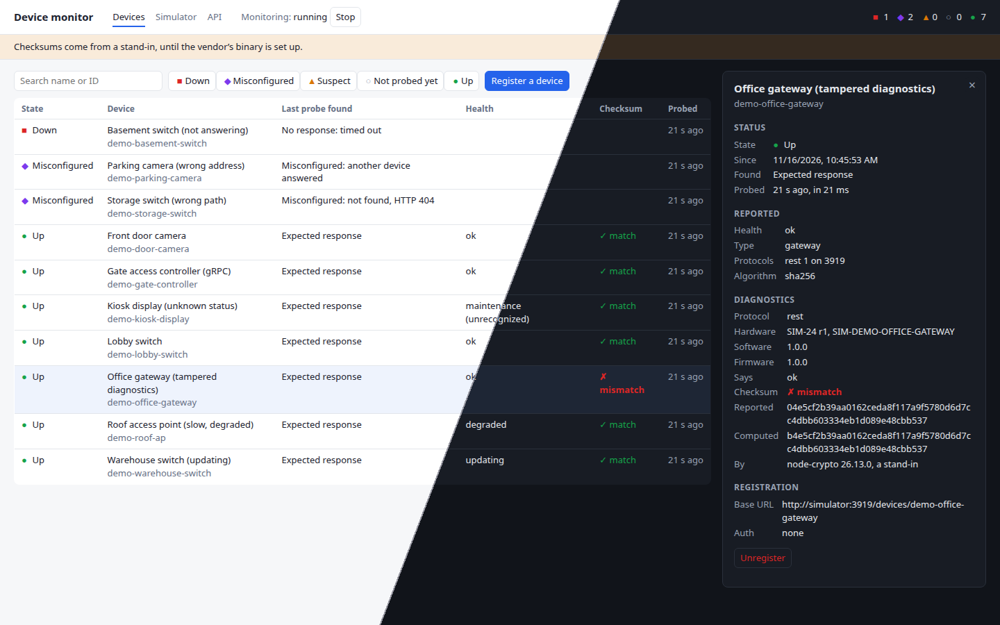

# Device Monitoring Service

A proof-of-concept service that monitors network devices and reports the latest status of each.

Reviewers: start with the [Reviewer guide](docs/REVIEWER.md).



## Contents

- [Quick start](#quick-start)
- [Stopping and cleaning up](#stopping-and-cleaning-up)
- [Documentation](#documentation)
- [Configuration](#configuration)
- [Device simulator](#device-simulator)

## Quick start

The only prerequisite is [Docker](https://docs.docker.com/get-docker/) with Docker Compose.

```bash
docker compose up --build --wait -d
```

The command returns once every service reports healthy. The following are then available:

| Resource          | Location                                                                                      |
|-------------------|-----------------------------------------------------------------------------------------------|
| Dashboard         | <http://127.0.0.1:8080>: device states ordered by severity, and controls for simulated devices |
| REST API          | `http://127.0.0.1:8080/v1`                                                                    |
| API reference     | <http://127.0.0.1:8080/docs/>                                                                 |
| Monitor logs      | `docker compose logs -f monitor`                                                              |

Notes:

- To serve on a different port, set the `GATEWAY_PORT` environment variable.
- The first build downloads the base images and npm packages. Subsequent starts work without network access.

## Stopping and cleaning up

| Command                                     | Effect                                                                        |
|---------------------------------------------|-------------------------------------------------------------------------------|
| `docker compose down`                       | Stops the stack and keeps its data.                                           |
| `docker compose down --volumes`             | Stops the stack and deletes its data.                                         |
| `docker compose down --volumes --rmi local` | Stops the stack and deletes its data and locally built images.                |
| `pnpm clean`                                | Development only: removes the Compose data and every `node_modules` directory. |

## Documentation

| Document                                | Contents                                                                 |
|-----------------------------------------|--------------------------------------------------------------------------|
| [Decisions](docs/DECISIONS.md)          | Requirements from the brief, open questions, and the decisions taken.   |
| [Architecture](docs/ARCHITECTURE.md)    | How the system is structured.                                            |
| [Development](docs/DEVELOPMENT.md)      | Local setup, commands, and checks.                                       |
| [Reviewer guide](docs/REVIEWER.md)      | Design overview, how to review the work, and next steps.                 |
| [Reply](docs/REPLY.md)                  | The response to the brief.                                               |

## Configuration

### Device credentials

Tokens for devices that use bearer authentication are read from `.env.devices`, one per line, in the form
`DEVICE_<NAME>=<token>`, where `<NAME>` matches the device's `secretRef`. The file is ignored by Git.

### Vendor checksum binary

Until the vendor's checksum binary is available, a built-in stand-in computes checksums, and every result is marked
accordingly. To use the vendor binary, place it in `vendor/` and its settings in `vendor/checksum.env` (both are ignored
by Git):

```bash
CHECKSUM_BINARY_PATH=/opt/vendor/checksum
CHECKSUM_BINARY_ALGORITHMS=sha256
CHECKSUM_BINARY_ARGS=["--algorithm", "{algorithm}"]
```

Requirements:

- Compose mounts `vendor/` read-only at `/opt/vendor`.
- The binary must target glibc (the image is Debian-based), match the host architecture, and be executable by the
  `node` user.
- The monitor refuses to start if it cannot execute the binary.

### Other settings

All remaining settings are documented in [Development › Running the monitor](docs/DEVELOPMENT.md#running-the-monitor).

## Device simulator

The stack includes a device simulator, so the monitor can be exercised without physical hardware.

### Default behaviour

- On startup, the simulator loads the ten devices defined in
  [`apps/simulator/demo-devices.json`](apps/simulator/demo-devices.json). Each illustrates one scenario: a healthy
  device, token authentication, gRPC-only diagnostics, a firmware update in progress, a slow and degraded device, an
  unrecognised status, tampered diagnostics, an unresponsive device, an impostor at the expected address, and an
  incorrect path.
- It registers these devices with the monitor at startup, leaving any device that is already registered unchanged.
- State is held in memory only; a restart restores the devices defined in the file.
- Inside Compose, the monitor reaches a simulated device at `http://simulator:4100/devices/<deviceId>`.

| Endpoint         | Host address                                  | Override variable        |
|------------------|-----------------------------------------------|--------------------------|
| Device API       | `http://127.0.0.1:4100/devices/<deviceId>`    | `SIMULATOR_DEVICE_PORT`  |
| Control API      | `http://127.0.0.1:4101`                       | `SIMULATOR_CONTROL_PORT` |
| gRPC diagnostics | `127.0.0.1:4102`                              | `SIMULATOR_GRPC_PORT`    |

### Example: inject a fault

Create a simulated device, register it with the monitor, then make it stop responding:

```bash
curl -X PUT http://127.0.0.1:4101/devices/sim-1 \
  -H 'content-type: application/json' \
  -d '{"deviceType":"switch"}'

curl -X POST http://127.0.0.1:8080/v1/devices \
  -H 'content-type: application/json' \
  -d '{"deviceId":"sim-1","name":"Simulated switch","baseUrl":"http://simulator:4100/devices/sim-1","auth":{"strategy":"none"}}'

curl -X PATCH http://127.0.0.1:4101/devices/sim-1 \
  -H 'content-type: application/json' \
  -d '{"health":"hangs"}'
```

### Control API

| Method   | Path                  | Description                              |
|----------|-----------------------|------------------------------------------|
| `GET`    | `/devices`            | Lists all simulated devices.             |
| `PUT`    | `/devices/<deviceId>` | Creates or replaces a device.            |
| `PATCH`  | `/devices/<deviceId>` | Updates selected settings of a device.   |
| `DELETE` | `/devices/<deviceId>` | Removes a device.                        |

Settings are accepted as provided, without validation (see decision D-63 in [DECISIONS](docs/DECISIONS.md)):

| Setting                                          | Default    | Description                                                                 |
|--------------------------------------------------|------------|-----------------------------------------------------------------------------|
| `health`, `diagnostics`                          | `normal`   | Response behaviour for the respective call (see below).                     |
| `status`                                         | `ok`       | Status the device reports about itself; any value, e.g. `maintenance`.      |
| `token`                                          | none       | Bearer token required on every request; otherwise the device returns 401.   |
| `delayMs`                                        | `0`        | Delay applied before every response.                                        |
| `dropNext`                                       | `0`        | Number of upcoming requests on which the connection is dropped.             |
| `deviceType`                                     | `switch`   | Device type.                                                                |
| `protocols`                                      | `["rest"]` | Protocols offered for diagnostics, in order of preference.                  |
| `hardware`, `softwareVersion`, `firmwareVersion` |            | Values reported in diagnostics.                                             |

### Response behaviours

| Value           | Behaviour                                              | gRPC equivalent                        |
|-----------------|--------------------------------------------------------|----------------------------------------|
| `normal`        | Responds correctly.                                    | `OK`                                   |
| `garbage`       | Returns JSON that does not match the device API.       | `OK` with a non-diagnostics payload    |
| `html`          | Returns an HTML page, as a captive portal would.       | `OK` with an HTML payload              |
| `fails`         | Returns HTTP 500.                                      | `INTERNAL`                             |
| `not_found`     | Returns HTTP 404.                                      | `NOT_FOUND`                            |
| `gateway_error` | Returns HTTP 502.                                      | `UNAVAILABLE`                          |
| `hangs`         | Never responds.                                        |                                        |
| `resets`        | Resets the connection.                                 | `UNAVAILABLE`                          |
| `truncates`     | Cuts the response off partway.                         | `DATA_LOSS`                            |
| `impostor`      | Health only: reports a different device ID.            |                                        |
| `tampered`      | Diagnostics only: returns a mismatched checksum.       |                                        |

### Running standalone

When started outside Compose (`pnpm --filter @device-monitor/simulator dev`), the simulator starts with no devices
unless `SIMULATOR_DEVICES_FILE` points to a device file. It registers devices only with the monitor given by
`SIMULATOR_MONITOR_URL`, using `SIMULATOR_DEVICE_BASE_URL` as their base address.

### Load testing with a simulated fleet

```bash
pnpm install
pnpm fleet:add          # adds 1001 devices by default; pass a count up to 10000, e.g. pnpm fleet:add 5000
pnpm fleet:remove       # removes all fleet-* devices and leaves others untouched
```

- Each device is created in the simulator and then registered with the monitor. Most devices are healthy; a small,
  deterministic share in every hundred is slow, degraded, failing, or unresponsive.
- The monitor logs `probed` and `durationMs` for every polling round. Increasing `MONITORING_MAX_CONCURRENT_PROBES`
  shortens rounds.
- Running `pnpm fleet:add` again after a simulator restart restores the fleet.
