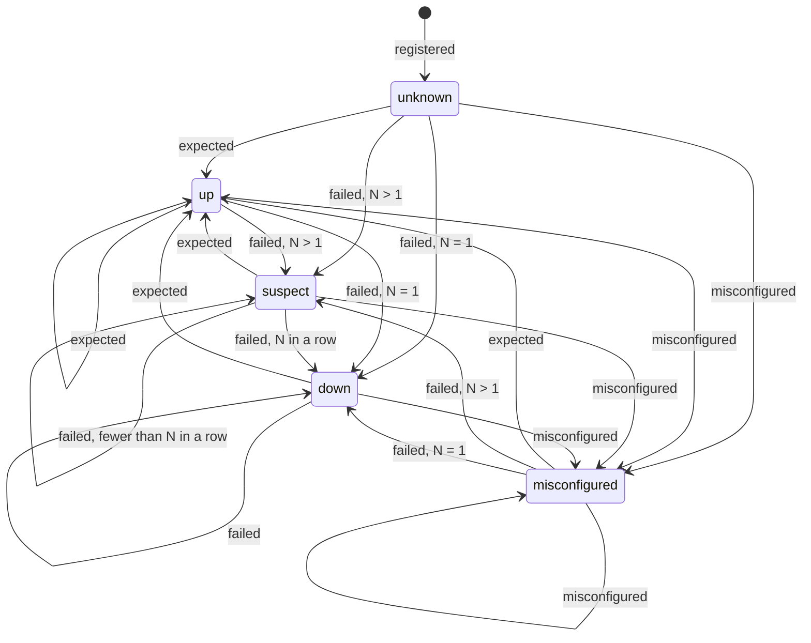

# Architecture

The monitor follows Ports and Adapters (D-21). In `apps/monitor/src`:

- `core/`: the domain and the application. Ports, in `core/ports`, say what the core offers and what it needs.
- `adapters/driving/`: what calls the core, through the ports it offers.
- `adapters/driven/`: what the core calls, through the ports it needs.
- `infrastructure/`: shared technology infra. It imports nothing of the monitor's.
- `config/`: reads the environment, and checks every setting at startup (D-48). Nothing else may read it.
- `main.ts`: the composition root. It builds the adapters and hands them to the core.

## Ports

| Port                      | Kind    | What it does                                       | Adapters                                                  |
|---------------------------|---------|----------------------------------------------------|-----------------------------------------------------------|
| `DeviceRegistry`          | driving | Registers and unregisters devices                  | `api-http`                                                |
| `DeviceStatusQueries`     | driving | Reads the latest status of every registered device | `api-http`                                                |
| `Monitoring`              | driving | Starts and stops monitoring                        | none yet                                                  |
| `DeviceProbes`            | driving | Probes every registered device                     | none yet                                                  |
| `DeviceDatastore`         | driven  | Stores the registered devices                      | `device-datastore-postgres`, `device-datastore-in-memory` |
| `DeviceStatusDatastore`   | driven  | Stores status of devices including diagnostics     | `device-status-datastore-in-memory`                       |
| `DeviceHealthReader`      | driven  | Reads a device's health and capabilities           | none yet                                                  |
| `DeviceDiagnosticsReader` | driven  | Reads a device's diagnostics, in one protocol      | none yet                                                  |
| `ChecksumGenerator`       | driven  | Generates the checksum of a device's answer        | none yet                                                  |

## Data concepts

Exposed through the API:

- **Device**: ID and name. Outlives its registration, so statuses and history can refer to it (D-26, Q-16).
- **Device Registration**: a device plus how to reach it: base URL and auth, whose token is named by `secretRef`,
  never held (D-38). Created by registering, which records when (`registeredAt`), removed by unregistering.
- **Device Status**: the monitor's conclusion about a device, and what the device reported (D-27). Fields below.
- **Monitoring State**: `running`, `stopping` or `stopped`. Rounds start only while running. Stopping lets the round
  in progress finish (D-32).

Internal:

- **Probe Outcome**: what one probe found: an expected response, or a failure (no response, an unexpected one, or a
  misconfigured registration) and why (Q-17). The next status follows from the previous one and the outcome.
- **Device Status History**: every status a device had, oldest first. Append-only, for offline inspection, never
  served by the API (R-13, Q-22).

What a device status expresses, and how:

| What                                             | How                                                                                    | For              |
|--------------------------------------------------|----------------------------------------------------------------------------------------|------------------|
| Whether the device is alive                      | `state`: `up` or `down`                                                                | R-03             |
| That a device is failing, before calling it down | `suspect`, with `failedProbes` and `since`                                             | R-10, R-11, D-28 |
| That it has not been probed yet                  | `unknown`                                                                              | R-09             |
| Why the last probe failed                        | `lastProbe`: no response, an unexpected one or misconfigured, why, and the HTTP status | R-11, Q-17       |
| That the registration is wrong, not the device   | `misconfigured`, with `lastProbe`                                                      | I-09, D-39       |
| What the device says about its health            | `health`, in its own words when the monitor does not know them                         | R-06, D-29       |
| What the device is and speaks                    | `capabilities`: type, protocols, checksum algorithm                                    | R-05, R-06, Q-01 |
| Its diagnostics                                  | `diagnostics`: HW, SW and FW versions, its status, or why they are unavailable         | R-07             |
| Whether the diagnostics arrived intact           | `checksum`: match or mismatch, the algorithm, and what made it, stand-in or binary     | R-14, R-15, Q-06 |
| When it was last seen, and what it reported then | `lastKnown`: `seenAt`, health, capabilities, diagnostics. May be out of date           | R-13, I-09       |
| Since when it has been in its current state      | `since`: registered for `unknown`, else when it entered the state                      | R-13             |
| When it was last probed, and how long it took    | `lastProbe`: `probedAt` and `durationMs`                                               | R-13, I-01       |

## Behavior

One driving port per concern, typed in `core/ports/driving/`. The HTTP API drives the first three, and the heartbeat drives `DeviceProbes`.

| Port                  | Operation            | Does                                                               | Expected failures       |
|-----------------------|----------------------|--------------------------------------------------------------------|-------------------------|
| `DeviceRegistry`      | `listDevices`        | Lists registered devices, by ID (D-30)                             | store                   |
|                       | `registerDevice`     | Registers a device. Its status starts `unknown`                    | `already_exists`, store |
|                       | `getDevice`          | Gets one registered device                                         | `not_found`, store      |
|                       | `updateDevice`       | Replaces name, base URL and auth                                   | `not_found`, store      |
|                       | `unregisterDevice`   | Stops probing a device. Its history stays (Q-16)                   | `not_found`, store      |
| `DeviceStatusQueries` | `listLatestStatuses` | Latest status of every registered device (R-08)                    | store                   |
| `Monitoring`          | `startMonitoring`    | Back to `running`. Probing resumes next round                      | —                       |
|                       | `stopMonitoring`     | `stopping` until the round in progress ends, then `stopped` (D-32) | —                       |
|                       | `getMonitoringState` | `running`, `stopping` or `stopped`                                 | —                       |
| `DeviceProbes`        | `probeDevices`       | Probes every registered device once: one round                     | store                   |

- A store failure is `unavailable`, `timeout` or `cancelled` (D-22).
- Device lists are not paged: up to about a thousand (Q-20).
- Device list changes apply from the next round, without a restart (R-09).
- Monitoring starts `running` with the service, so the demo needs no extra step (D-31).

Driven ports, typed in `core/ports/driven/` with the domain model (D-25).

| Port                      | Operation            | Does                                                | Expected failures       |
|---------------------------|----------------------|-----------------------------------------------------|-------------------------|
| `DeviceDatastore`         | `listDevices`        | Lists registrations, by ID (D-30)                   | store                   |
|                           | `getDevice`          | Gets one registration                               | `not_found`, store      |
|                           | `insertDevice`       | Adds a registration                                 | `already_exists`, store |
|                           | `updateDevice`       | Replaces a registration                             | `not_found`, store      |
|                           | `deleteDevice`       | Removes a registration                              | `not_found`, store      |
| `DeviceStatusDatastore`   | `appendStatus`       | Appends a status to a device's history              | store                   |
|                           | `listLatestStatuses` | Newest status of each device                        | store                   |
| `DeviceHealthReader`      | `readHealth`         | Reads health, ID and capabilities, over REST (Q-03) | device call             |
| `DeviceDiagnosticsReader` | `readDiagnostics`    | Reads diagnostics, in one protocol (Q-04)           | device call             |
| `ChecksumGenerator`       | `generateChecksum`   | Checksums a payload with an algorithm (Q-06)        | checksum                |

- A device call failure is no response or an unexpected one, and why, as for a failed probe (Q-17).
- A diagnostics call can also fail on auth or TLS, on its own port. Its failure carries the protocol, and the HTTP or
  gRPC status whenever there is one: a gRPC call always ends with one.
- A checksum failure is `unsupported_algorithm`, `generator_unavailable`, `timeout`, `failed` or `invalid_output`. The
  probe still got the expected response, and its Checksum Result is `unavailable`, with why and the generator.
- One diagnostics reader per protocol, REST and gRPC, each with the versions it speaks (Q-02).
- One checksum generator at a time: the vendor's binary, or the stand-in until it arrives (Q-07).

## HTTP API

The `api-http` adapter serves the driving ports over HTTP, with Fastify (D-46). The request and response schemas live
in `packages/contracts/monitor-api`, which clients can use too (D-45). The OpenAPI document is generated from the
routes, and served with an API reference at `/docs/` (D-50).

- Every API path starts with its major version, `/v1`, so a change that breaks clients can come as `/v2` beside it
  (D-47). `/docs` has none: it is for people, not for API clients.
- Collections are plural nouns: `/v1/devices`, with `/v1/devices/{deviceId}` for one device, and `/v1/device-statuses`
  for the latest status of every device. It is not under `/v1/devices/`, where its name would take a path a device ID
  could need.
- Values such as a status's `state` stay lowercase, `up` rather than `ONLINE`.
- An error answers with a `code`, such as `device_not_found`, a `message`, and `details` when there are any, plus the
  HTTP `statusCode` and its `statusName`, such as `NOT_FOUND`, the `requestPath`, the `requestId` and the `timestamp`.
  The `requestId` is a UUID, and the service logs each request under it as `reqId`, so an error a client reports can
  be found in the log.
- A store call is aborted only when the client goes away before the response is sent.

## Device states

The state follows from the previous status and the probe outcome alone. What the device reports never changes it
(D-27). `N` is the `downProbeThreshold` setting.

- **Expected**: the expected response. One is enough to be `up` again (D-28).
- **Failed**: no response or an unexpected one. Both count toward `down` (Q-17, D-28).
- **Misconfigured**: an answer showing the registration is wrong, not the device: 401/403, 404 on the health path,
  another device answering (its ID is not the registered one, Q-23), a TLS failure, or no token to send. One is
  enough, and it never counts toward `down` (D-39).
- `since` changes only with the state.

## Monitoring model

The heartbeat triggers a round: one probe per registered device. A probe is a sequence of steps, and steps that call
the device are retried per the retry policy. Each probe yields one outcome, and the device's next status follows.

| Term      | What it is                                                   | Limit                                      | Concurrency           |
|-----------|--------------------------------------------------------------|--------------------------------------------|-----------------------|
| Heartbeat | Driving adapter. Next round starts `interval` after one ends | Stop timeout, derived: the probe budget    | 1 round at a time     |
| Round     | One pass over registered devices, started only while running | None. Estimated, not enforced              | `maxConcurrentProbes` |
| Probe     | Health call > pick a protocol > diagnostics call > checksum  | Probe budget, derived: sum of its steps    | Steps in sequence     |
| Step      | One part of a probe. Health and diagnostics call the device  | Step budget, or a timeout for the checksum | —                     |
| Attempt   | One try of a device call                                     | Attempt timeout                            | —                     |

- Diagnostics are read only after a health call that answers (D-34), in the device's most preferred protocol that the
  monitor speaks (Q-04).
- Stopping the service aborts everything below it. Nothing is recorded for an aborted probe.
- False alarms are absorbed twice: by attempts within a call (seconds), then by `N` failed probes before `down`
  (rounds).

#### Timeouts and budgets

Per D-37: a **timeout** limits one indivisible wait (an attempt, a query, a process run, waiting for a stop). When it
passes the outcome is unknown, and the caller may retry. A **budget** limits a group of operations, with the retries
and waits between them. When it passes the group ends, and no retry starts. Every timeout sits in a budget, with room
left for a retry. A budget is configured, or derived from what it contains.

| Limit               | Kind             | Default                      |
|---------------------|------------------|------------------------------|
| Health attempt      | timeout          | 3 s (Q-12)                   |
| Health step         | budget           | 7 s: two attempts and a wait |
| Diagnostics attempt | timeout          | 3 s                          |
| Diagnostics step    | budget           | 7 s                          |
| Checksum step       | timeout          | 2 s                          |
| Probe               | budget, derived  | 16 s                         |
| Heartbeat stop      | timeout, derived | the probe budget             |

The service warns at startup when a step's attempts and waits do not fit its budget.

#### Retry policy

Per D-35 and D-36, one policy for all devices:

- Per device call. A call that succeeded is never repeated.
- Only on no response or a 5xx. Any other answer would come back the same.
- Exponential backoff with full jitter, so retries from many devices spread out:
  `delay = random(0, min(base × 2^retry, maxDelay))`.
- Jitter only shortens a wait, so attempts still fit their step's budget.

#### Rounds and their duration

Rounds never overlap: the next starts `interval` after one ends (D-33). A round takes about
`devices / maxConcurrentProbes × time per probe`. A silent device takes the longest: its health budget, as
diagnostics are skipped.

At the stand, rounds take seconds. With a thousand failing devices (Q-09), a 7 s health budget and 30 s between rounds
(Q-08), keeping a round within the interval needs about 230 probes at once. Each round's duration is logged, so one
longer than the interval is seen (I-01).

#### Concurrency risks

A probe's steps run in sequence, so device connections equal probes at once. Not measured for the PoC (D-05): event
loop delay with many devices answering at once, CPU for TLS handshakes with many HTTPS devices, and DNS lookups, which
use a small thread pool.

## Storage

- **Devices**: one row per registration, unique device ID. A surrogate key, if any, is never exposed.
- **Device status history**: append-only, one row per status. A device's latest status is its newest row.
- What a device reported is stored as JSON, as it differs per device type.
- Times are points in time, with their time zone.
- One instance writes (D-04) and rounds never overlap, so writes to a device's status never race.
